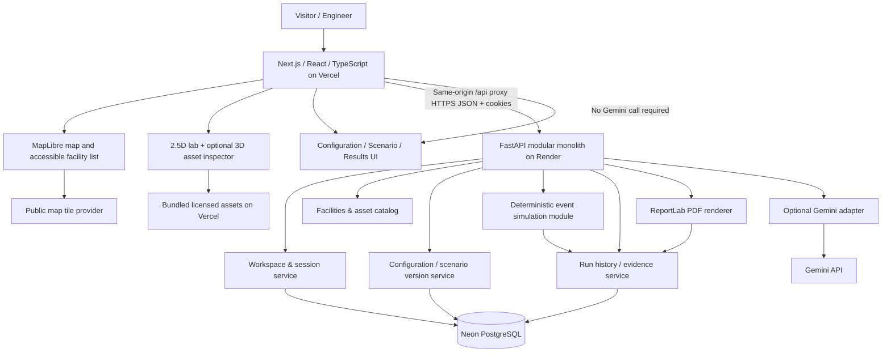

# GridProof — System Architecture & Technology Decisions

**Document:** `docs/03-system-architecture.md`  
**Version:** 1.0 — implementation baseline  
**Date:** October 17, 2026  
**Status:** Proposed technical design based on approved product decisions  
**Sources of truth:** [01 Product Requirements](./01-product-requirements.md) v1.1 and [02 User Flows & Acceptance Criteria](./02-user-flows-and-acceptance-criteria.md) v1.1  
**Audience:** Software engineer implementing the SHPE MVP

> **Boundary:** GridProof is an **independent Cummins-inspired educational prototype**. Locations are public reference points; equipment models, facility layouts, operating inputs, test results and reports are synthetic. It does not access, control or certify real equipment. This architecture does **not** introduce AWS, Kubernetes or a production cloud infrastructure program. Vercel + a managed web-service host + managed PostgreSQL are enough for this release.

## 1. Architecture goals and binding decisions

1. Deliver the **map → Fridley virtual lab → configure → simulate → investigate → compare → PDF** journey without relying on AI.
2. Demonstrate **API-first full-stack software**, relational data modeling, multi-subsystem state integration, automated testing, traceable engineering outputs, and security controls relevant to Cummins' Software Engineer I posting.
3. Use **one modular backend**, not microservices; isolation happens through modules and contracts. Complete the project before SHPE rather than investing in distributed infrastructure for its own sake.
4. Keep the **simulation deterministic and framework-independent**: no LLM-derived physics, random fixture outcomes, or animation-as-simulation.
5. Persist **configuration versions, scenario revisions, and immutable run evidence** on the server; no account/registration flow in MVP.
6. Generate a **real PDF from persisted run snapshots**; current unsaved edits cannot alter an old report.
7. Keep Gemini optional and quota-limited: one explicit drafting request, structured output validation, user approval, and manual fallback.
8. Use independent GridProof branding and licensed/bundled 2.5D/3D assets, with accessible fallbacks and disclosure on site and reports.

### Job-description fit, without technology theater

| Relevant Cummins skill | Demonstrated by GridProof | Not claimed |
|---|---|---|
| Full-stack APIs + database | Typed Next.js client, FastAPI/OpenAPI, PostgreSQL persistence | Enterprise production scale |
| Telemetry and multi-subsystem analysis | Time-ordered **simulated** asset event trace and derived states | Real IoT ingestion or physical equipment connectivity |
| Logging and cloud troubleshooting | Structured request IDs, health endpoint, host logs, error handling | AWS CloudWatch or actual distributed observability platform |
| Distributed architecture familiarity | Clear client/API/DB boundaries, failure contracts, stateless API process | Needlessly deployed microservices or message broker |
| Agent / AI literacy | Optional Gemini structured test drafting with explicit human approval | Autonomous electrical control or continuous agents |
| Agile testing and modeling | Contract tests, invariant/property tests, Playwright E2E, ADRs, CI | Regulatory certification or production commissioning approval |
| Security / compliance awareness | Input validation, isolated anonymous workspaces, redaction, immutable evidence | SOC 2 or real-world regulatory compliance certification |

## 2. High-level architecture diagram



**Key simplification:** The simulator is a pure Python module *inside* the FastAPI deployment. There is **no additional simulation microservice**, queue, MQTT broker, WebSocket server, or background worker for V1. A bounded small scenario runs synchronously; results are persisted before success is returned.

**Frontend/backend origin strategy:** Browser uses `/api/*` on the frontend origin; a Vercel rewrite forwards to the Render API. This avoids putting a backend URL in every browser request and allows first-party `HttpOnly` demo-session cookies. Verify proxy cookie behavior in staging; if hosting limits prevent correct forwarding, use a same-site custom subdomain with explicit CORS/cookie configuration rather than silently loosening cookie security. Render is a conventional managed app host here, **not an AWS deployment**.

## 3. Technology stack and rationale

| Layer | Choose | Why this choice / time constraints |
|---|---|---|
| Web framework | **Next.js (App Router) + React + TypeScript** | Strong typed frontend, familiar Vercel deployment, route-based UX and reusable components |
| Styling/UI | **Tailwind CSS + shadcn/ui** | Fast accessible tables/dialogs/forms without building a bespoke design system |
| Data fetching | **TanStack Query** + generated/typed API types | Fetch/caching/error states; React local state for selection and replay only |
| Geographic map | **MapLibre GL JS** + tested public tile/style provider | Open map API, clickable site markers; accessible hardcoded facility list fallback |
| Physical scene | **Bundled 2.5D site image/SVG with positioned hotspots** | Most visual impact for least development risk; hotspots bound to asset IDs |
| Focused 3D inspector | **React Three Fiber / Three.js**, lazy-loaded GLB/glTF | Rotation/zoom on a selected asset, only if properly licensed; bundled static image fallback |
| Charts/schematic | **Recharts for metrics**, **SVG/React** for single-line diagram | Easy common-state rendering, controllable labeling and accessibility |
| Backend API | **Python 3.12+ / FastAPI / Pydantic v2** | Automatic OpenAPI, strict schemas, strong ecosystem for simulation and PDF |
| Persistence | **PostgreSQL (Neon) + SQLAlchemy 2 + Alembic** | Versioned relational data and JSONB immutable snapshots; managed DB without custom ops |
| Simulation | **Pure Python, `heapq` discrete-event queue + state machines** | Deterministic, independently unit-testable, small footprint; no external engine needed |
| PDF | **ReportLab** on backend | Reliable server-side PDF generation directly from saved evidence; no headless browser required |
| Optional LLM | **Google Gemini via server-side SDK** | One test-draft call, short timeout, allowlist validation, cached approved examples; no required call in demo |
| Test suite | **pytest, Hypothesis (select invariants), httpx, Playwright, Vitest** | Domain behavior, API isolation, E2E workflows and component tests |
| CI | **GitHub Actions** | Lint, typecheck, tests and build; no cloud orchestration |
| Deployment | **Vercel web + Render API + Neon Postgres** | Consistent with existing portfolio deployment approach; independent services simple to operate |
| Logging | **Python structured JSON logs + platform logs**, request/correlation ID | Sufficient for diagnosing MVP faults without a dedicated ELK stack |

**Why no AWS now?** The job description names AWS familiarity, but the user explicitly chose Vercel-style deployment for this phase. Design APIs and stateless services cleanly so an AWS migration can be discussed later; **do not represent Render/Neon hosting as AWS experience**.

**Versions:** Pin exact compatible dependency versions and lockfiles during implementation; version numbers here are family selections, not a claim that the latest releases have been tested.

## 4. Main components and responsibilities

| Component | Owns | Does not own |
|---|---|---|
| Facility directory | Three verified site metadata records; map pins; Fridley route | Simulated telemetry for real sites |
| Virtual lab presentation | 2.5D SVG/image, hotspots, asset list, 3D/static inspector | Electrical behavior calculations |
| Configuration editor | Editable supported fields, optimistic-concurrency version save UX | Mutation of completed runs |
| Scenario authoring | Six templates, manual structured editing, approvals, validation feedback | Unchecked arbitrary executable scripts |
| API / workspace module | Anonymous session, endpoint authorization, validation, response formatting | Browser-side stored database secrets |
| Catalog module | Immutable seed equipment definitions, site labels, safe parameters | Proprietary Cummins installed-base data |
| Simulation engine | Event ordering, source states, connectivity, bounded energy/power allocation, assertions | Power-flow/transient engineering or actual controls |
| Evidence repository | Store and retrieve **immutable** run inputs/events/metrics/assertions/status | Computing fake results for missing runs |
| Replay/presentation | Time-index recorded events/frames and redraw all surfaces from same snapshot | Re-running a different simulation during scrub |
| Report service | Assemble PDF from a *stored run snapshot* with disclaimers | HTML screenshot as authoritative evidence |
| Gemini draft adapter | Translate user intent into schema-constrained candidate scenario | Approval, calculation, or automatic execution |

**Implementation layout (suggested):**

```text
gridproof/
├── apps/web/                    # Next.js frontend
│   ├── app/page.tsx             # Facility map
│   ├── app/lab/fridley/page.tsx # Lab shell with tabs/panels
│   ├── components/{map,lab,assets,scenario,results,replay}/
│   ├── lib/api/                 # Typed client / generated OpenAPI types
│   └── public/assets/          # Attribution manifest + bundled 2.5D/GLB/images
├── apps/api/
│   ├── app/main.py              # FastAPI composition / middleware
│   ├── app/routes/              # Facilities, configs, scenarios, runs, reports, AI
│   ├── app/domain/              # Pydantic + explicit domain enums
│   ├── app/simulation/          # Pure event engine, state models, assert evaluators
│   ├── app/services/            # Versioning, workspace auth, exports
│   ├── app/persistence/         # SQLAlchemy models/repositories, Alembic migrations
│   └── tests/                   # Unit, API, determinism, security fixtures
├── docs/                        # PRD, flows, architecture, ADRs
├── .github/workflows/ci.yml
└── README.md
```

## 5. Data ownership and storage model

**Database is the system of record.** The client retains temporary drafts, UI selections, and replay cursor only. Browser state is not authoritative for saved configs or results.

| Table | Key fields (illustrative) | Rule |
|---|---|---|
| `demo_workspaces` | `id`, `token_hash`, `created_at`, `expires_at` | One server-issued anonymous, scoped workspace; short retention |
| `facility_catalog` | `id`, `name`, `geo`, `kind`, `is_interactive`, `source_note` | Verified site directory seeded by migrations; no live readings |
| `configurations` | `id`, `workspace_id`, `name`, `latest_version`, `created_at` | Mutable *pointer* to latest immutable version |
| `configuration_versions` | `id`, `configuration_id`, `version_number`, `snapshot_json`, `schema_version`, `created_at` | Append-only once created |
| `scenarios` | `id`, `workspace_id`, `name`, `latest_revision`, `template_origin` | Six global templates plus workspace drafts |
| `scenario_revisions` | `id`, `scenario_id`, `revision`, `definition_json`, `schema_version`, `created_at` | Validated, immutable revisions |
| `simulation_runs` | `id`, `workspace_id`, `config_version_id`, `scenario_revision_id`, `status`, `model_version`, `config_snapshot_json`, `scenario_snapshot_json`, `events_json`, `frames_json`, `metrics_json`, `assertions_json`, `error_code`, `created_at`, `completed_at` | Append-only inputs/output for completed runs; status can transition *only* while pending/running |

**Recommendation:** JSONB for deterministic run snapshots and event frames is reasonable at the MVP's bounded size. Add indexes on `(workspace_id, created_at DESC)` and parent version FKs. Don't introduce a timeseries database or store one database row per simulated timestep for a handful of short scenarios.

**Invariants and retention:**

- Assign every config/scenario version a stable ID. Save creates a *new* version in a transaction, with `expected_version` required for conflict detection; never overwrite an old version.
- A run references exact version IDs and stores copies of both input snapshots, simulation/model version, the ordered event trace, frames, metrics, and assertion evidence. `Completed` runs cannot be edited or deleted by normal APIs.
- Create/run/result/report operations are scoped by **workspace_id** derived server-side from the session; callers cannot specify arbitrary workspace ownership.
- Use UUIDs for public record identifiers; UUID obscurity is **not** authorization.
- Proposed MVP session/data retention: **7 days** of inactivity or age (choose fixed 7-day expiration for simpler enforcement), with a documented daily cleanup job or bounded manual cleanup during the MVP. No promise of permanent storage or user accounts.
- Never store Gemini prompts containing credentials or private client operational data; the app uses only synthetic test descriptions.

### Workspace session design

- `GET /api/v1/session` provisions/reuses a random opaque demo-session token using a cryptographically secure generator. The API stores only a hash, issues the token as `Secure; HttpOnly; SameSite=Lax; Path=/` cookie via the same-origin proxy, and returns an opaque public workspace ID if needed for display.
- On every protected request, server resolves the token to an unexpired workspace; missing/expired sessions get a clear `401 WORKSPACE_EXPIRED` response and recovery option (start a new demo). Avoid auto-creating a new workspace on retrieval of a previously saved run.
- The browser **never stores** the cookie value in JS, URL query, localStorage, or sessionStorage. Session loss means old anonymous runs cannot be recovered without the session; the UI discloses that.
- Apply CSRF defense for unsafe methods: check `Origin`/`Referer` against the frontend allowlist, require `application/json` for JSON writes, and use `SameSite=Lax` cookies. Rate-limit by IP/session where the host permits.
- Anonymous workspaces are *demo isolation*, not strong user identity. Don't collect confidential user data.

## 6. Simulation model: design contract

### 6.1 Inputs and asset relationships

Seed one **Fridley-inspired fictional lab**: generators `G1` and `G2` (each **250 kW**), BESS (**250 kW inverter / 500 kWh usable**), utility, breaker/switchgear connections, critical load (**180 kW**), and adjustable load bank. These are **synthetic values**, not Fridley equipment inventory. Components have stable asset IDs shared with UI and schematic.

Supported values include generator startup delay, start failure, equipment/breaker faults, load, initial battery SOC, event times, and acceptance thresholds. Reject invalid values (negative ratings, nonexistent asset IDs, SOC outside 0–100, unsupported event types) at API boundaries **and** in the domain validator.

### 6.2 Pure deterministic execution

`simulate(config_snapshot, scenario_revision, model_version) -> SimulationResult`:

1. Validate complete input and canonicalize number/time units (use integer milliseconds/seconds and integer Wh or fixed precision; document rounding).
2. Initialize utility, generator, breaker, battery and load states.
3. Enqueue scenario events in `(sim_time, explicit_priority, sequence_number)` order using `heapq`, ensuring ties are resolved deterministically.
4. Process each event and compute resulting power-source connectivity and allowable dispatch; a running generator behind an open breaker contributes **zero** delivered power.
5. Enforce inverter kW and usable battery energy limits, bounded SOC, and demand conservation: **delivered + unserved = required load**, within documented numeric tolerance.
6. Record state snapshots at each meaningful event and at bounded fixed sampling intervals if necessary for chart/replay. Do not fabricate curves between recorded states without labeling interpolation.
7. Evaluate requirements using observed trace/metrics (e.g. `G1_READY_WITHIN_10S`, `CRITICAL_LOAD_RESTORATION`, `MIN_BESS_SOC`). A start-readiness failure is **not automatically** a critical-load failure.
8. Return ordered events, recorded frames, calculated metrics, assertion evidence, and engine version; no database or network access from core simulation.

**Baseline showcase:** same seed scenario and acceptance threshold; `G1.startup_delay_seconds = 5` produces readiness **pass**, while a new saved version with `15` produces readiness **fail** against a **10-second** deadline. Both runs must use the actual simulator and be independently persisted. Critical-load continuity is evaluated separately and may have a different outcome.

**Model exclusions:** no voltage/frequency transient waveform modeling, synchronization physics, detailed protection coordination, short-circuit studies, or real commissioning certification. Power and event outcomes must be described as **simplified modeled behavior**.

### 6.3 Execution boundaries

- Limit number of assets, events, simulated horizon, and frame count at schema level. Suggested initial caps: **20 assets, 100 scenario events, 30 simulated minutes, 2,000 recorded frames**; revise based on measured benchmarks.
- Execute small runs inside FastAPI's worker/threadpool so the async server event loop isn't blocked; use an application-level timeout and resource limits. **No queue for V1.** If timeouts are observed after benchmarking, move simulation execution to a worker as a later ADR.
- On success, atomically persist the run snapshot and return its stable ID; on failure, persist `Error` with a safe diagnostic correlation ID and **no fabricated pass/fail assertions**.
- `POST /runs` accepts an `Idempotency-Key` to avoid accidental duplicate runs due to retries or double-clicks, scoped to workspace/request fingerprint.
- Benchmark all six scenarios at target hosted tier and confirm **≤5 seconds** server simulation runtime under documented test conditions; don't claim the number before measurement.

## 7. Data flows / what happens when a request arrives

### A. Initial visit and facility selection

1. Browser loads `/` from Vercel; UI immediately shows a branded independent-prototype notice and facility map or accessible site-list fallback.
2. `GET /api/v1/session` creates/reuses demo workspace; `GET /api/v1/facilities` returns static verified location catalog (seeded, cached).
3. MapLibre loads a third-party tile style; marker selection opens a grounded site info card.
4. **Fridley** → `/lab/fridley`; **Seymour/Daventry** → information-only card; never fabricate live site statuses.
5. If tiles fail, the list and direct Fridley navigation continue working.

### B. Inspect and configure

1. Lab fetches synthetic asset catalog + currently saved config version.
2. User selects hotspot/keyboard list item; side inspector displays the same asset ID and config as schema/SVG/optional 3D asset.
3. User changes a supported value. Form validates locally and via API; unsaved changes trigger save/discard/cancel when leaving or launching a run.
4. `POST /configurations/{id}/versions` creates an immutable version after comparing the client's `expected_version` to current. Conflict returns `409`, inviting reload/diff rather than silently overwriting.

### C. Manually author and run

1. User selects a seeded template or creates a test in the manual editor.
2. `POST /scenarios/validate` returns field-specific issues without executing it; user confirms then saves scenario revision.
3. User selects explicit configuration version and scenario revision and presses **Run Simulation**.
4. `POST /runs` authorizes session, loads versioned snapshots, validates both, runs deterministic engine, records evidence and returns run ID/result summary.
5. UI navigates to run results. All numbers are backend-computed; no browser-only fake pass/fail data.

### D. Replay, compare, export

1. `GET /runs/{id}` returns saved trace/frames/assertions/metrics (bounded JSON; pagination if future sizes grow).
2. Playback uses a selected timestamp/index in the recorded run; **site view, SVG diagram, asset inspector, timeline and chart** derive from that exact frame.
3. `GET /runs/compare?left=...&right=...` verifies both belong to same workspace and flags incompatible scenarios; compares saved inputs and results, not live drafts.
4. `GET /runs/{id}/report.pdf` builds a PDF from the saved run's immutable evidence. Response includes `application/pdf`, appropriate filename, disclosures and source IDs. If report generation fails, the in-app results remain accessible.

### E. Optional Gemini draft (one user-triggered request)

1. User enters a short natural-language scenario description and clicks **Draft with AI**.
2. Frontend calls `POST /ai/scenario-draft`; API checks quota/rate limit, truncates to allowed size, sends only synthetic context and supported schema to Gemini with server-side key.
3. Pydantic parses output to a *draft*, rejects invented asset IDs/unsupported events, and returns validation issues if needed.
4. User edits/approves the draft before saving; **AI never executes, approves, or computes a test**.
5. On unavailable key, timeout, provider error or rate limit, preserve prompt and user edits; provide bundled template + manual editor. Page load, playback, report generation and normal simulation use **zero Gemini calls**.

## 8. API design and communication contracts

**Protocol:** Browser ↔ `/api/v1` over HTTPS, REST/JSON, OpenAPI-documented schemas. REST is sufficient; there is no need for WebSockets in deterministic replay. Static/GLB assets use HTTPS from Vercel. MapLibre tiles use an external map provider; Gemini is invoked only by the API backend.

| Method + endpoint | Responsibility | Request / result (summary) |
|---|---|---|
| `GET /api/v1/health` | Host health check | `200` + service/build version; no secrets |
| `GET /api/v1/session` | Issue/reuse workspace cookie | Session status, workspace display ID, expiry |
| `GET /api/v1/facilities` | Map facility directory | Verified markers, feature flags, source note |
| `GET /api/v1/labs/fridley/assets` | Physical scene + inspector data | Assets, stable IDs, labels, static/3D asset URLs |
| `GET /api/v1/configurations/current` | Working configuration | Config ID + version snapshot |
| `POST /api/v1/configurations/{id}/versions` | Save version | JSON config, `expected_version` → new version ID |
| `GET /api/v1/scenarios` | Six templates and workspace scenarios | Catalog / revision metadata |
| `POST /api/v1/scenarios/validate` | Validate draft | Field errors or normalized draft |
| `POST /api/v1/scenarios` | Save approved scenario/revision | Stable scenario revision ID |
| `POST /api/v1/runs` | Deterministic execution | `config_version_id`, `scenario_revision_id`, idempotency key → run ID/status |
| `GET /api/v1/runs` | Workspace run history | Paginated run summaries |
| `GET /api/v1/runs/{id}` | Read immutable evidence | Snapshot IDs, frames, ordered events, metrics, assertions |
| `GET /api/v1/runs/compare` | Compare saved evidence | `left`, `right` query IDs → verified differences |
| `GET /api/v1/runs/{id}/report.pdf` | PDF evidence export | `application/pdf` file download |
| `POST /api/v1/ai/scenario-draft` | Optional Gemini draft | Natural language → candidate draft + validation flags |

**Example: saved run request**

```http
POST /api/v1/runs
Content-Type: application/json
Idempotency-Key: 9c1b...random-per-click...
Cookie: gridproof_demo=<http-only; sent automatically>

{"config_version_id":"<uuid>","scenario_revision_id":"<uuid>"}
```

**Example: assertion evidence in response (illustrative, not precomputed demo result)**

```json
{
  "run_id": "<uuid>",
  "status": "completed",
  "model_version": "sim-v1",
  "assertions": [
    {
      "requirement_id": "G1_READY_WITHIN_10S",
      "status": "fail",
      "observed_seconds": 15,
      "threshold_seconds": 10,
      "evidence_event_ids": ["event-0008"]
    }
  ]
}
```

**Consistent error contract** (every API error):

```json
{
  "error": {
    "code": "VALIDATION_ERROR",
    "message": "Configuration contains unsupported values.",
    "details": [{"field": "battery.initial_soc_pct", "reason": "Must be between 0 and 100"}],
    "request_id": "req-..."
  }
}
```

**HTTP behavior:** `400/422` validation, `401` expired/missing session, `403` forbidden where distinguishable without leaking resource existence, `404` missing/not-owned records (prefer `404` for cross-workspace lookups), `409` stale version/idempotency conflict, `429` AI quota/rate limit, `503` temporary provider/DB issue, `500` unexpected internal failure. Use stable error codes, accessible retry/repair guidance, and no stack traces in browser responses.

### Contract evolution

- Generate TypeScript OpenAPI types from FastAPI's schema as part of the build/CI; server owns authoritative validation rules.
- Keep an `api/v1` route namespace and `schema_version` on stored simulation/config definitions. Avoid premature API version proliferation.
- Return UTC ISO-8601 timestamps for server records and integer simulated offsets for reproducibility. Never confuse actual wall time with simulated time.
- Explicitly version the simulation rules (`model_version`) so past runs are interpretable after implementation changes.

## 9. Error handling and component failure behavior

| Failure | Backend behavior | UI behavior / preserved capability |
|---|---|---|
| Map provider/tile unavailable | API site catalog still responds | Accessible facility list, direct Fridley navigation |
| Missing GLB/WebGL unsupported | No backend impact | Static render + full keyboard-operable asset details |
| Configuration invalid | Reject before save/run with field errors | Keep draft; focus first error; offer correction |
| Concurrent edit/stale version | `409 VERSION_CONFLICT`; no overwrite | Reload/diff or save new version explicitly |
| Network disconnected during save | No optimistic success until API ACK | Preserve unsaved form and retry safely |
| Double-click/timeout on run request | Scoped idempotency token prevents duplicate logical run | Poll/get known run by key if response lost; do not invent success |
| Simulation invariant failure | Explicit `Error` run with sanitized diagnostic | No pass/fail badge; prior runs remain viewable |
| Database unavailable | Return `503` / no claimed saved run | Show outage and retry; existing static map/assets remain |
| PDF rendering fails | Log request/run ID; return clear `500/503` | Display persisted evidence in app; retry report |
| Gemini key missing, quota, timeout | `503/429` with stable error code | Preserve prompt, offer manual editor/sample scenario |
| Session expired/cookie cleared | `401 WORKSPACE_EXPIRED`, never attach old workspace arbitrarily | Start fresh demo, explain anonymous history availability |
| Unsupported scenario request | Schema/domain reject | No execution; display supported events/assets |

**Transaction order:** Create a run as `pending`, then execute and persist `completed` or `error` in controlled transitions. If process crashes mid-run, a startup/periodic recovery check marks stale `pending/running` records as `error` rather than treating them as passing or leaving them forever spinning. Use bounded simulation duration and idempotency keys; avoid introducing a queue solely for this recovery problem.

## 10. Security and privacy considerations

- **Input trust:** Validate everything server-side with Pydantic and explicit domain constraints; do not trust UI sliders, Gemini drafts, asset references, or record IDs. Never evaluate user expressions, arbitrary Python, or LLM-generated scripts.
- **Workspace isolation:** Lookups must include `workspace_id`. Test guessed UUIDs from a second workspace: return nonrevealing `404`. Use high-entropy cookie sessions, expiration, `HttpOnly`, `Secure`, and CSRF origin checking.
- **Secrets:** `DATABASE_URL`, `GEMINI_API_KEY`, session-token hashing/signing secrets and any provider credentials live only in Render/Neon/Vercel server environment configuration as appropriate; **never** in `NEXT_PUBLIC_*`, Git, static bundles, logs or response bodies. Keep a committed `.env.example` with placeholders.
- **Browser/transport:** HTTPS everywhere, narrow CSP for map tiles/3D assets, escape untrusted text, restrictive CORS, origin checks, and secure default headers. Avoid wildcard `Access-Control-Allow-Origin` with credentials.
- **Resource limits:** Small max request body, max prompt size, bounded events/simulation duration, AI daily per-session cap, API/IP rate limiting where supported; protect against cost/CPU exhaustion.
- **PDF:** All fields from validated snapshots, safely escaped/laid out; no user-supplied file access, shell command, or arbitrary HTML rendering.
- **Provenance:** Attribute licensed models/images; do not copy official Cummins identity. Label representative equipment and synthetic numerical results on the map, lab and reports.
- **Privacy:** MVP asks for no login or actual company datasets; use synthetic fixtures. Document 7-day demo retention; no promise that anonymous sessions are appropriate for sensitive projects.
- **Auditability:** Record run IDs, config/scenario/version links and safe request correlation IDs. Log failures/latency but redact cookies, API keys, prompts and personal information.

## 11. Deployment and operations (no AWS infrastructure)

```text
GitHub repository
   ├── Vercel: Next.js UI, static models, /api reverse proxy
   ├── Render Web Service: FastAPI app, migration/deploy commands
   └── Neon: managed PostgreSQL database
Optional: Gemini API and hosted map tiles (not critical to simulation)
```

**Environment setup:**

- **Vercel:** deploy `apps/web`; configure `/api/:path*` rewrite to Render `/api/:path*`; set only nonsecret public map configuration if needed; bundle core models/images locally.
- **Render:** deploy `apps/api` as a Python web service, run Alembic migration as a controlled predeploy/release step; configure environment variables, instance timeout and HTTPS; use `uvicorn` with modest worker count. Health endpoint reports app readiness; do not expose DB credentials in readiness output.
- **Neon:** one MVP database, pooled connection endpoint if needed, SSL enabled, migration role access restricted where practical. Use SQLAlchemy connection-pool settings suitable for host resource tier.
- **GitHub Actions:** lint/typecheck frontend, lint backend, pytest simulator/API, run integration tests with ephemeral PostgreSQL in CI, build frontend, then optional Playwright smoke against deployed preview. No secrets required for unit tests; Gemini mocked.
- **Environments:** local `.env`, one deployable preview/staging configuration, production/demo. Seed synthetic facilities/configs/scenarios through idempotent migration or seed script.
- **Availability caveat:** free/low-cost Render services may cold-start or sleep and managed databases may have connection limits. Test full demonstration on actual deployed tier **before** SHPE; a locally runnable Docker Compose fallback is strongly recommended. Map tiles may require internet; provide accessible facility navigation without tiles.
- **Release check:** deployed P0 workflow, run persistence after refresh, cross-session isolation, no-Gemini demonstration, PDF validity, and six scenario benchmarks.

### Local developer experience

Run `docker compose up` for PostgreSQL + FastAPI where useful, and `pnpm dev` (or npm scripts) for Next.js. Seed fixtures, run `pytest`, run frontend tests, then Playwright smoke. No AWS account or external Gemini request required to develop the simulator.

## 12. Observability, testing and release gates

**Logging/monitoring:** Emit structured records `{timestamp,level,service,request_id,route,status,duration_ms,run_id?,error_code?}`. Track simulation duration and success/error, database write failures, PDF export failures, Gemini calls/429 counts and 5xx rates. Use Render/Vercel logs for MVP; no need for Grafana/ELK in week one.

**Test pyramid:**

1. **Pure domain unit tests:** generator transitions, breakpoint/connectivity, SOC bounds, power conservation, restoration-time computation, deterministic tie ordering; targeted Hypothesis cases for invariants.
2. **Golden scenario fixtures:** all six scenarios; repeated identical input produces byte-for-byte canonical ordered events/assertions; **G1 5s passes and 15s fails readiness 10s** without hardcoding result.
3. **API integration:** Pydantic errors, version conflict, workspace isolation, idempotency, persisted run integrity, report from old snapshot, database failure behavior.
4. **UI components:** form validation, keyboard equipment list, selected asset sync, static fallback, disabled/unavailable buttons.
5. **Playwright E2E:** map → Fridley → inspect → save → select scenario → run → inspect → compare → PDF; repeat with Gemini disabled; refresh saved run and ensure original evidence.
6. **Deployed smoke/performance:** six timed simulated runs on hosting tier, report produced/readable, static asset loads, maps degraded gracefully.

**Exit criteria:** Every P0 criterion in document 02 passes, the P1 features actually shipped pass their own criteria, baseline/modification outcomes are measured, PDF is valid, secrets are absent from client builds, and synthetic/non-affiliation disclosures are visible. Report measurements rather than claiming planned targets as achieved.

## 13. Trade-offs and alternatives considered

| Decision | Chosen | Alternative | Why now / revisit trigger |
|---|---|---|---|
| API architecture | Single FastAPI modular monolith | Several microservices | Avoid deployment complexity; split if genuine scaling/team boundaries emerge |
| Frontend | Next.js on Vercel | Plain React/Vite | Existing workflow and routing; Vite also valid if Next.js becomes friction |
| Database | Managed Postgres / Neon | SQLite browser/local or DynamoDB | Server-side versioning and queries; SQLite could work only for truly single-user local demo |
| Simulator | Pure `heapq` discrete-event engine | SimPy; real power-system simulators | Transparent deterministic state behavior; adopt SimPy if custom event machinery expands |
| Simulation transport | Synchronous REST | Celery/Redis/queue, WebSocket | Six small runs under 5s target; add job processing only if measured runtime requires it |
| Site visual | Static 2.5D map with hotspots | Fully modeled free-roam 3D facility | Maximum visual quality within 2 weeks; keep optional focused 3D inspector |
| Map | MapLibre + external tiles | Mapbox, Google Maps, static SVG | Open and flexible; fallback protects demo from tile outage |
| Evidence | JSONB immutable run snapshots + PDF renderer | Timeseries store + object storage; browser print | Auditability and simple deployment; object storage only if PDF retention grows |
| Identity | Opaque 7-day anonymous workspace cookie | User accounts/JWT provider | No auth in PRD; add accounts before any real customer or multi-user product |
| AI | One server-side Gemini drafting tool | Full agent / continuous inference | Quota constraint and trustworthiness; manual authoring remains primary |
| Hosting | Vercel + Render + Neon | AWS ECS/RDS/Lambda; other managed hosts | Meets explicit no-AWS-now choice; modular contracts allow future migration |

## 14. Implementation order and unresolved engineering checks

### Recommended build order

1. **Foundation:** repo, typed domain schemas/OpenAPI, Postgres migrations, anonymous workspace sessions, seeded site/config/scenario data.
2. **Simulation core:** state machines, event queue, invariants, deterministic fixtures and flagship readiness regression; tests before UI animations.
3. **Persistence/API:** immutable versions/runs, workspace enforcement, idempotency and error contracts.
4. **User-facing lab:** map-first landing, facility card, hybrid equipment presentation, config + scenario forms.
5. **Results:** stored trace/replay, linked assertion evidence, comparison view and PDF export.
6. **Optional polish:** focused GLB inspector, Gemini draft authoring, cross-browser performance/accessibility work.

### Engineering checks to resolve through spikes, not scope changes

- Confirm **Vercel rewrite → Render `Set-Cookie` forwarding** in a staging test before implementing all session calls. If incompatible, use a properly configured same-site API domain rather than exposing session tokens to JS.
- Inspect licensing and feasibility of the actual 2.5D/GLB assets before choosing visual positions; scene must work without WebGL.
- Verify Render+Neon startup/reconnect behavior and the six-scenario **≤5s** target under deployed conditions.
- Validate PDF generation and readability from canonical saved run evidence with no local browser dependencies.
- Treat Gemini quota as **zero available by default**; use mocked adapter and manual flows in CI.

### Decisions already locked (not open for reinterpretation)

Map first; Fridley is the sole interactive lab; hybrid 2.5D + focused 3D/static fallback; independent GridProof branding; optional AI **test drafting only**; server-side anonymous workspace persistence; **PDF** evidence export; G1 5s→15s readiness regression against 10s threshold; no AWS deployment for this phase.

**Architectural thesis:** Build a correct, small engineering system with strong boundaries and reproducible evidence, then make its physical machinery and test consequences visually legible. The map and 3D model invite attention; validated simulation and traceability earn engineering credibility.
