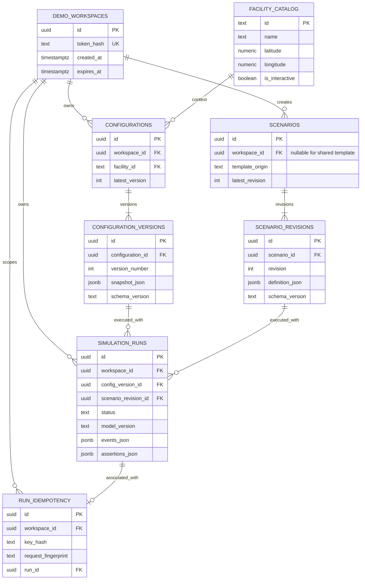

# GridProof — Database Design

**Document:** `docs/04-database-design.md`  
**Version:** 1.0 · 2026-10-17  
**Status:** Proposed implementation contract for Step 4  
**Depends on:** [PRD v1.1](./01-product-requirements.md), [User Flows v1.1](./02-user-flows-and-acceptance-criteria.md), [Architecture](./03-system-architecture.md), [API Contracts](./05-api-contracts.md)

## 1. Purpose and boundaries

PostgreSQL (Neon), accessed only by the FastAPI backend using SQLAlchemy 2 and Alembic, is the **system of record** for anonymous demo workspaces, versioned configuration/scenario definitions, and immutable simulation evidence. Frontend component state (map selection, camera, unsaved form input, replay cursor) is ephemeral. Simulation results are derived from persisted version snapshots, never recomputed for display or PDF export. The data is **synthetic**, and no Cummins operational/employee/customer data is used.

**Locked decisions:** anonymous server-side workspace session; 7-day fixed retention; one fully interactive Fridley virtual lab; six seeded scenario templates; G1 5 s → 15 s startup-delay flagship test with a distinct `G1_READY_WITHIN_10S` assertion; PDF from saved evidence; Gemini optional. `MVP` in this document includes P0 plus the agreed PDF/run-comparison showcase P1; Gemini remains P2.

## 2. Entity-relationship diagram



`facility_catalog` and shared scenario templates are admin-seeded, read-only public catalog data. The system must **not** allow anonymous users to edit global templates or facilities.

## 3. Relational schema (column-level specification)

All timestamps are UTC `TIMESTAMPTZ`; UUIDs are server-generated UUIDv4 (or another server-generated random UUID). Foreign keys are enforced at the database level. Prefer `ON DELETE RESTRICT` for immutable evidence dependencies, and purge expired workspaces in a deliberate child-first cleanup transaction.

### `demo_workspaces`
| Column | SQL type | Rule |
|---|---|---|
| `id` | UUID | PK |
| `token_hash` | VARCHAR(128) | NOT NULL UNIQUE; hash of random opaque cookie token; never store plaintext token |
| `created_at` | TIMESTAMPTZ | NOT NULL DEFAULT now() |
| `expires_at` | TIMESTAMPTZ | NOT NULL, fixed 7 days after creation |

Index `ix_workspaces_expiry(expires_at)` for cleanup. Expiration is enforced in application lookups, even before scheduled deletion.

### `facility_catalog`
| Column | SQL type | Rule |
|---|---|---|
| `id` | VARCHAR(40) | PK; `fridley`, `seymour`, `daventry` |
| `name` | VARCHAR(160) | NOT NULL |
| `city`, `region`, `country` | VARCHAR(120) | NOT NULL |
| `latitude`, `longitude` | NUMERIC(9,6) | NOT NULL; -90..90 and -180..180 |
| `facility_type` | VARCHAR(80) | NOT NULL |
| `is_interactive` | BOOLEAN | NOT NULL DEFAULT false; only Fridley true |
| `description`, `source_url`, `source_note` | TEXT | NOT NULL; public-fact attribution and disclaimers |
| `catalog_version` | INTEGER | NOT NULL DEFAULT 1 |

Seed three entries from verified public material; coordinates and descriptions must be checked during seed creation, not fabricated. Site details are public-context information, **not** real-time telemetry.

### `configurations`
| Column | SQL type | Rule |
|---|---|---|
| `id` | UUID | PK |
| `workspace_id` | UUID | NOT NULL FK → `demo_workspaces.id` |
| `facility_id` | VARCHAR(40) | NOT NULL FK → `facility_catalog.id`; V1 `fridley` only |
| `name` | VARCHAR(100) | NOT NULL; trimmed, 1..100 chars |
| `latest_version` | INTEGER | NOT NULL DEFAULT 0; nonnegative pointer |
| `created_at`, `updated_at` | TIMESTAMPTZ | NOT NULL |

Index `(workspace_id, updated_at DESC)`. V1 creates one default configuration for each new workspace, with seeded version 1. More configurations could be added later but no new creation endpoint is required for this MVP.

### `configuration_versions`
| Column | SQL type | Rule |
|---|---|---|
| `id` | UUID | PK |
| `configuration_id` | UUID | NOT NULL FK → `configurations.id` RESTRICT |
| `version_number` | INTEGER | NOT NULL CHECK >= 1 |
| `schema_version` | VARCHAR(32) | NOT NULL e.g. `config-v1` |
| `snapshot_json` | JSONB | NOT NULL object; server-validated `SystemConfigV1` |
| `created_at` | TIMESTAMPTZ | NOT NULL |

UNIQUE `(configuration_id, version_number)`; index `(configuration_id, version_number DESC)`. All fields except identity and insert timestamp are immutable. Validate `snapshot_json` using Pydantic before insert, plus key DB CHECK constraints at the relational layer; avoid pretending PostgreSQL alone validates all nested JSON fields.

**Config snapshot contract (`SystemConfigV1`, illustrative):**
```json
{
  "facility_id": "fridley",
  "equipment": {
    "g1": {"rated_kw": 250, "startup_delay_s": 5, "enabled": true},
    "g2": {"rated_kw": 250, "startup_delay_s": 5, "enabled": true},
    "battery": {"inverter_kw": 250, "usable_kwh": 500, "initial_soc_pct": 80, "min_soc_pct": 20},
    "utility": {"available": true},
    "switchgear": {"mode": "auto"},
    "load": {"critical_kw": 180}
  }
}
```
`equipment` keys are stable asset IDs. In V1, rated powers and supported topology are seeded/locked; users edit only exposed supported fields, chiefly startup delays, critical load and initial SOC. All configuration changes must materially affect simulator inputs or be clearly marked informational. **Validation**: startup delay `0..120` seconds (finite); SOC `0..100` with `initial_soc_pct >= min_soc_pct`; critical load `1..500` kW (may intentionally exceed support for overload tests); boolean switches only enumerated supported values; reject unknown IDs and unsupported schema versions. No user-defined physical wiring or arbitrary code.

### `scenarios`
| Column | SQL type | Rule |
|---|---|---|
| `id` | UUID | PK |
| `workspace_id` | UUID | Nullable FK; `NULL` means read-only global template |
| `name` | VARCHAR(100) | NOT NULL, trimmed |
| `template_origin` | VARCHAR(24) | NOT NULL CHECK IN (`seed`, `manual`, `ai_draft_approved`) |
| `latest_revision` | INTEGER | NOT NULL DEFAULT 0 |
| `created_at`, `updated_at` | TIMESTAMPTZ | NOT NULL |

Index `(workspace_id, updated_at DESC)`; seed six global scenario records. A user editing a global template must **fork** into a new workspace-owned scenario; never modify the shared record.

### `scenario_revisions`
| Column | SQL type | Rule |
|---|---|---|
| `id` | UUID | PK |
| `scenario_id` | UUID | NOT NULL FK → `scenarios.id` RESTRICT |
| `revision` | INTEGER | NOT NULL CHECK >= 1 |
| `schema_version` | VARCHAR(32) | NOT NULL e.g. `scenario-v1` |
| `definition_json` | JSONB | NOT NULL object; validated `ScenarioV1` |
| `created_at` | TIMESTAMPTZ | NOT NULL |

UNIQUE `(scenario_id, revision)`. Immutable once inserted.

**Scenario snapshot (`ScenarioV1`, illustrative):**
```json
{
  "duration_s": 60,
  "events": [
    {"at_s": 0, "type": "utility_outage", "target_asset_id": "utility"},
    {"at_s": 0, "type": "start_generator", "target_asset_id": "g1"}
  ],
  "assertions": [
    {"requirement_id": "G1_READY_WITHIN_10S", "type": "asset_ready_within", "target_asset_id": "g1", "trigger_event_type": "start_generator", "max_delay_s": 10},
    {"requirement_id": "CRITICAL_LOAD_CONTINUITY", "type": "unserved_energy_at_most", "max_unserved_kwh": 0}
  ]
}
```
Validation: `duration_s` integer 1..600; event count 1..30; assertion count 1..20; times integer 0..duration; `target_asset_id` in supported equipment IDs; allowed event types only (`utility_outage`, `utility_restore`, `start_generator`, `generator_start_failure`, `breaker_fail_close`, `set_load_kw`, `set_battery_soc_pct`); event-specific payloads typed/limited; timestamps sorted deterministically with stable tie-break; requirement IDs unique within revision; thresholds finite/nonnegative. Reject contradictory impossible actions rather than silently altering them. In the flagship scenario, G1-ready assertion has `max_delay_s: 10`. The battery/load continuity assertion is computed independently from G1 startup success.

### `simulation_runs`
| Column | SQL type | Rule |
|---|---|---|
| `id` | UUID | PK |
| `workspace_id` | UUID | NOT NULL FK; owner of this run |
| `config_version_id` | UUID | NOT NULL FK to exact saved config version |
| `scenario_revision_id` | UUID | NOT NULL FK to exact saved scenario revision |
| `status` | VARCHAR(16) | NOT NULL CHECK IN (`pending`, `running`, `completed`, `error`) |
| `model_version` | VARCHAR(40) | NOT NULL |
| `config_snapshot_json`, `scenario_snapshot_json` | JSONB | NOT NULL; immutable copied inputs |
| `events_json`, `frames_json`, `metrics_json`, `assertions_json` | JSONB | Nullable until completed; NOT NULL logical requirement when `completed` |
| `error_code` | VARCHAR(60) | Nullable; sanitized machine-readable error |
| `created_at`, `started_at`, `completed_at` | TIMESTAMPTZ | `created_at` NOT NULL; timestamps set by lifecycle |

Index `(workspace_id, created_at DESC, id DESC)` for stable pagination; indexes on `(config_version_id)`, `(scenario_revision_id)`, `(status, created_at)` for stale-run recovery. Optionally constrain `status='completed'` implies output columns nonnull with a SQL CHECK. A run has a bounded event/frames payload (limits enforced before persistence). `frames_json` are sampled state snapshots for replay, never fabricated client side.

Lifecycle: `pending → running → completed` **or** `pending/running → error`; no transitions out of `completed` or `error`. Only internal simulation runner updates allowed status/result columns. **Do not update/delete completed run content** via user routes. `error` runs remain useful for debugging, but no test-pass status is claimed.

### `run_idempotency` (explicit supporting table)
| Column | SQL type | Rule |
|---|---|---|
| `id` | UUID | PK |
| `workspace_id` | UUID | NOT NULL FK |
| `key_hash` | VARCHAR(128) | NOT NULL; hash of client-supplied idempotency key |
| `request_fingerprint` | VARCHAR(128) | NOT NULL; canonical hash of config/scenario IDs and request schema |
| `run_id` | UUID | NOT NULL UNIQUE FK → `simulation_runs.id` |
| `created_at` | TIMESTAMPTZ | NOT NULL |

UNIQUE `(workspace_id, key_hash)`. Same key + same request returns same run; same key + different request → `409 IDEMPOTENCY_CONFLICT`. Insert idempotency and pending run in one transaction. This table is required to make the API's retry contract reliable.

## 4. Invariants and transactional operations

1. **Workspace isolation:** Resolve workspace from hashed cookie, never from request body. Join child records through their parent and scope every read/write by current workspace. Shared templates allowed only as read-only `workspace_id IS NULL`.
2. **Version save:** `SELECT ... FOR UPDATE` configuration; compare supplied `expected_version` against `latest_version`; on match insert `configuration_versions(n+1)` and update pointer in a single transaction; mismatch `409 VERSION_CONFLICT`, no overwrite.
3. **Scenario save:** POST creates a workspace-owned scenario with revision 1; edit existing scenario by posting `scenario_id` + `expected_revision` and create revision N+1 transactionally. Fork global template instead of editing global row.
4. **Run creation:** Verify version ownership (config's parent workspace) and scenario ownership or seed status; snapshot both revisions and `model_version`; atomically insert pending run and idempotency record.
5. **Run completion:** Simulate bounded deterministic work outside transaction; update pending/running record once with complete evidence and terminal status. Never commit partial success.
6. **Report:** PDF generated on demand from one *completed saved run*. No PDF bytes need storage in V1; generated output remains semantically identical for a given stored run and report-template version (generation timestamp may differ).
7. **Cleanup:** Expired workspaces and children removed in controlled order (idempotency, runs, config/scenario revisions through parents, workspace), without deleting shared global templates or the public facility catalog. If the database is unreachable, never claim a saved result.

## 5. Data lifecycle and query patterns

- `GET /session`: indexed `token_hash`, check `expires_at > now()`; initialize default Fridley config + version in a single transaction.
- `GET /configurations/current`: latest version via `(configuration_id, version_number)` join.
- `GET /scenarios`: global templates + workspace scenarios, revisions resolved by `latest_revision`, never other users' drafts.
- `POST /runs`: idempotency lookup (workspace + hashed key), exact input versions and snapshots.
- `GET /runs`: keyset pagination by `(created_at DESC, id DESC)` (or bounded offset for V1; contract uses cursor), page size default 20 max 50.
- `GET /runs/{id}`: workspace-qualified lookup, return full stored evidence in timestamp order.
- `GET /runs/compare`: two workspace-qualified completed runs, compare stored snapshots/metrics; flag incompatible scenarios/model versions, do not fabricate percentage improvement.
- `GET /runs/{id}/report.pdf`: same stored evidence, no simulation rerun.

Estimated scale: short 60–600 s modeled simulations, six templates and tens of runs per workspace; single-table JSONB evidence is appropriate. Set hard bounds and monitor serialized evidence size; do not add TimescaleDB, Kafka or Redis before measured need.

## 6. Migration and seed plan

1. Alembic migration 001: workspaces + static facility catalog.
2. Migration 002: configurations/versions; seed default config at workspace creation, not globally.
3. Migration 003: scenarios/revisions; idempotent six-template seed by stable logical identifier (migration data seed must not duplicate rows on rerun).
4. Migration 004: runs + idempotency + indexes and CHECK constraints.
5. Test migrations against a fresh PostgreSQL instance and an already-migrated instance. Seed scripts must be reproducible and additive, not destructive.

Schema changes use new `schema_version` with a migration/adapter or a compatibility error; never reinterpret historical snapshots using new rules. `model_version` is stored on each run because simulation logic may evolve.

## 7. Data integrity, privacy and security tests

- Workspace B receives `404` when guessing A's run/config/scenario IDs; cookie must not be readable by JS.
- Two simultaneous saves with `expected_version=1`: exactly one creates version 2, the other gets `409`.
- Same idempotency key + payload creates precisely one run, including after retries.
- Saved run remains unchanged after newer configuration/scenario versions are created; reports match old run.
- Unknown equipment/event/extra JSON keys and nonfinite numerical fields are rejected.
- Crash after `running`: stale-run recovery marks `error` and preserves prior completed runs.
- Expired session does not resurrect prior data; cleanup never removes shared template rows.
- No Gemini prompt, API key, session cookie, or sensitive customer content stored in evidence or logs.

## 8. Trade-offs, open implementation details

| Decision | Selected | Not selected and why |
|---|---|---|
| Evidence persistence | PostgreSQL JSONB snapshots | Separate event-per-row timeseries DB: needless overhead for short deterministic runs |
| Versioning | Append-only version/revision rows | In-place edits: would invalidate reproducibility |
| Session | Random opaque cookie, hashed DB token | Accounts/OAuth: too much MVP scope |
| Concurrency | Row locks + expected version/revision | Last-write-wins: silent lost updates |
| Idempotency | Workspace-key unique table | Browser button disable alone: insufficient after timeouts |
| Reports | Generate PDF from saved run | Persist PDFs immediately: extra storage/cost without product value |
| Deletes | Expiry-only cleanup | Self-service deletion and retention configuration: post-MVP |

**Clarification for implementation:** This is an implementable proposed schema, not evidence of deployed tables. Exact facility coordinates, verified public catalog text, asset licensing and model calibration must be checked when seeding. See [API Contracts](./05-api-contracts.md) for request/response shapes and status codes.
