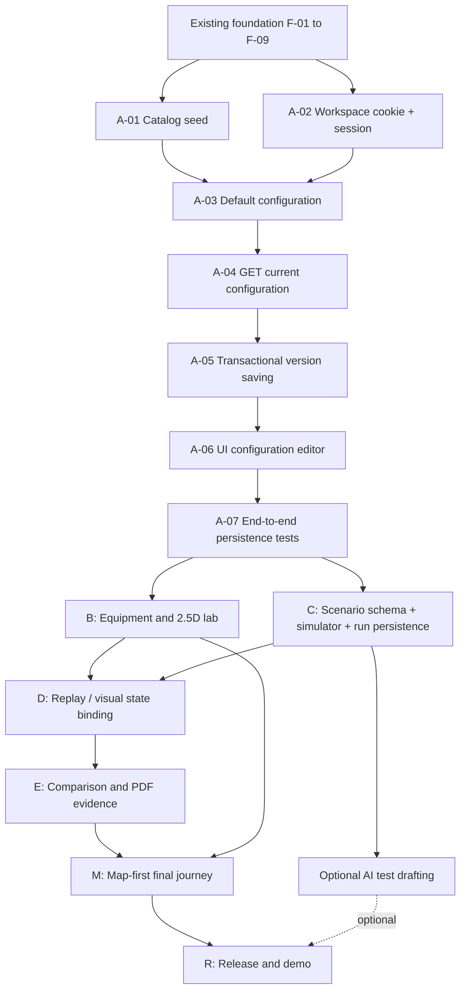

# GridProof — Implementation Roadmap

**File:** `docs/10-implementation-roadmap.md`  
**Version:** 1.0 · October 17, 2026  
**Status:** Implementation planning — executable task backlog  
**Product:** Independent, Cummins-inspired Virtual Power Integration & Commissioning Workbench

## 1. Purpose and execution rules

This roadmap turns the approved product, behavior, architecture, database, and API specifications into **ordered, independently verifiable tasks** for a solo developer or AI coding assistant. It favors vertical slices: finish a user action across API, persistence, frontend, tests, and documentation before starting another major feature.

**Sources of truth (in order of scope authority):**
- [`01-product-requirements.md`](01-product-requirements.md) — scope and priorities
- [`02-user-flows-and-acceptance-criteria.md`](02-user-flows-and-acceptance-criteria.md) — behavior and acceptance criteria
- [`03-system-architecture.md`](03-system-architecture.md) — component boundaries and deployment
- [`04-database-design.md`](04-database-design.md) — schema, immutability, tenancy, migration plan
- [`05-api-contracts.md`](05-api-contracts.md) — request/response and error contracts

When a task requires a contract change, update the relevant specification and automated tests in the **same change**. Do not silently alter approved user flows to fit implementation convenience.

### Locked MVP decisions

- **Landing experience:** verified Cummins facility map first; Fridley is the *only* fully interactive virtual lab. Seymour and Daventry show sourced informational context only.
- **Visualization:** clickable 2.5D facility plus focused 3D equipment inspector with static-image fallback; use licensed assets, not invented product specifications.
- **Identity:** independent GridProof branding, explicit non-affiliation with Cummins, synthetic operational data.
- **AI:** optional, user-triggered Gemini-assisted **test drafting**, never necessary for simulation, results, reports, or demonstration; validated structured drafts and manual fallback.
- **Persistence:** Neon PostgreSQL on the server, anonymous seven-day isolated demo workspaces, immutable configuration/scenario snapshots and saved simulation evidence.
- **Report:** downloadable PDF generated from a previously completed saved run (no re-execution).
- **Flagship scenario:** G1 startup readiness at 5 s (pass) versus 15 s (fail), using a 10 s requirement; critical-load continuity evaluated **independently**.
- **Deployment:** Next.js on Vercel, FastAPI on Render, PostgreSQL on Neon; no AWS deployment in this milestone.

### Status, priority, effort definitions

| Field | Meaning |
|---|---|
| **Done** | Implemented and verified by reported execution, commit, or inspection |
| **Ready** | Prerequisites available; next work can begin |
| **Blocked** | Depends on prerequisite or external resource not yet delivered |
| **Planned** | Specified but not implemented |
| **P0** | Mandatory for working MVP and flagship flow |
| **P1** | High-value convention-quality usability and evidence |
| **P2** | Optional stretch, including Gemini |

**Effort:** rough *focused engineering hours* for a solo developer familiar with the stack, excluding third-party approval, provider incidents, and learning spikes. Estimates are planning aids—not promises. A task is complete only when its completion criteria are met.

## 2. Verified baseline — what exists now

Current status reflects the latest user-reported local executions and GitHub progress, not an assumption that unspecified endpoints already work.

| ID | Deliverable | Priority | Status | Evidence / completion criterion | Effort remaining |
|---|---|---|---|---|---|
| F-01 | Product and technical specifications (`docs/01`–`05`) | P0 | **Done** | Requirements, flows, architecture, ERD, and API contract written | 0 h |
| F-02 | GitHub repo and monorepo directories | P0 | **Done** | `vhugo23/gridproof` on `main`; files pushed | 0 h |
| F-03 | Next.js 16 + TypeScript frontend | P0 | **Done** | Local dev server, lint, typecheck, production build passed | 0 h |
| F-04 | FastAPI backend and Next.js API rewrite | P0 | **Done** | `/api/v1/health` works directly and through frontend | 0 h |
| F-05 | Neon SQLAlchemy connection | P0 | **Done** | Live `SELECT 1` and `/api/v1/health/database` returned connected | 0 h |
| F-06 | Alembic migrations 001 and 002 | P0 | **Done** | Five tables present; `alembic check` clean; revision `2bfd8b6ca353` | 0 h |
| F-07 | Frontend/backend test, lint, format tooling | P0 | **Done** | pytest 2 pass, Vitest 2 pass, Ruff, ESLint, Prettier, typecheck/build pass | 0 h |
| F-08 | GitHub Actions CI | P0 | **Done** | Both CI jobs green per latest user confirmation | 0 h |
| F-09 | Root README and local instructions | P0 | **Done** | Updated README confirmed in GitHub; current setup documented | 0 h |
| F-10 | Cross-platform reproducible npm lockfile / restore `npm ci` in CI | P1 | **Planned** | Ubuntu and Windows `npm ci` succeed from same committed lockfile; CI uses `npm ci` | 2–4 h |
| F-11 | Real database integration test harness | P0 | **Ready** | Tests run against isolated PostgreSQL with migrations; never mutate production Neon | 3–5 h |

**Database currently present:** `alembic_version`, `demo_workspaces`, `facility_catalog`, `configurations`, `configuration_versions`. Tables are **not** proof that workspace/session endpoints or version-save services exist yet. The only confirmed backend routes are health checks.

## 3. Delivery map and critical path

**First vertical slice / immediate next work:** A-01 → A-02 → A-03 → A-04 → A-05 → A-06 → A-07. Resist starting a second major screen until this entire path works.

## 4. Ordered task backlog

### Phase A — Anonymous session + configuration persistence (P0)

**Deliverable:** a visitor loads synthetic Fridley config v1, changes G1 `startup_delay_s` 5 → 15, saves v2, reloads, and retrieves both immutable versions. Implement backend-first substeps but finish the React interaction before exiting the phase.

| ID | Task | Depends on | Priority | Status | Estimate | Completion criterion |
|---|---|---|---|---|---|---|
| **A-01** | Seed verified public facility catalog (`fridley`, `seymour`, `daventry`), with source attribution | F-05, F-06 | P0 | **Ready** | 2–3 h | Idempotent seed inserts exactly three verified facilities; Fridley interactive only; no invented coordinates or live operations |
| **A-02** | Implement `GET /api/v1/session` and secure anonymous workspace cookie | F-05, F-06 | P0 | **Ready** | 4–6 h | Cryptographic token hash in DB; HttpOnly/Secure/SameSite settings; fixed 7-day expiry; cookie reuse; missing/expired/foreign session tests |
| **A-03** | Pydantic `SystemConfigV1` + initial workspace-owned Fridley configuration v1 | A-01, A-02 | P0 | **Blocked** | 4–6 h | Each new workspace receives exactly one config with canonical equipment IDs and G1=5s; schema rejects unknown fields, bad SOC/ranges |
| **A-04** | Implement `GET /api/v1/configurations/current` | A-03 | P0 | **Blocked** | 2–3 h | Returns current workspace version only, typed response, proper 401/404/503 handling |
| **A-05** | Implement `POST /api/v1/configurations/{id}/versions` transactionally | A-04 | P0 | **Blocked** | 5–7 h | Row lock + `expected_version`; 201 v2; history unchanged; 409 on conflict; cross-workspace 404; invalid 422 |
| **A-06** | Build minimal frontend configuration editor + save/reload/error states | A-04, A-05 | P0 | **Blocked** | 4–6 h | Adjust G1 delay, save, refresh, see persisted 15s; clear loading, validation, conflict, outage states |
| **A-07** | End-to-end configuration and security tests | A-01…A-06, F-11 | P0 | **Blocked** | 4–6 h | Tests cover 5→15, concurrent saves, immutable v1, expired cookie, isolation across two workspaces and failure recovery |

**Exit gate A:** Show a real browser-to-Neon transaction and confirm reload persistence; demonstrate `409` conflicts and that v1 is never overwritten. No simulation required yet.

### Phase B — Physical equipment model and inspection (P0 core; P1 polish)

| ID | Task | Depends on | Priority | Status | Estimate | Completion criterion |
|---|---|---|---|---|---|---|
| **B-01** | Define stable asset catalog, connections, physical labels and renderer contract | A-03 | P0 | **Planned** | 3–4 h | `g1`, `g2`, battery, utility, switchgear, load correspond exactly to configuration IDs; documented fixed topology |
| **B-02** | Source/license representative equipment images and limited GLB/glTF models | B-01 | P1 | **Planned** | 3–6 h | Provenance/license recorded; no fake Cummins specifications; fallback image per asset |
| **B-03** | Implement `/api/v1/labs/fridley/assets` and 2.5D clickable lab | B-01, A-06 | P0 | **Planned** | 6–9 h | Selecting asset highlights it and opens correct info; synthetic notice visible; no misleading live data |
| **B-04** | Focused React Three Fiber asset inspector and static fallback | B-02, B-03 | P1 | **Planned** | 5–8 h | Supported GLB rotates/zooms; loading/error fallback works on mobile and unsupported devices |
| **B-05** | Link asset inspector to saved settings and error states | B-03, A-06 | P0 | **Planned** | 2–4 h | G1 inspector reflects current saved version; no independent invented client state |

**Exit gate B:** User clicks a visual generator, inspects it, edits its actual stored input, and sees the same data in the editor and inspector.

### Phase C — Scenario catalog and deterministic simulation (P0)

| ID | Task | Depends on | Priority | Status | Estimate | Completion criterion |
|---|---|---|---|---|---|---|
| **C-01** | Define Pydantic `ScenarioV1` event/assertion schemas and deterministic ordering | A-03, B-01 | P0 | **Planned** | 4–6 h | Supported event/asset types and bounds enforced; contradictory and unsupported inputs rejected |
| **C-02** | Add scenario/revision SQLAlchemy models + Alembic Migration 003 | C-01, F-06 | P0 | **Planned** | 3–5 h | Tables, immutable revisions, ownership constraints; migration and `alembic check` pass |
| **C-03** | Seed six approved global read-only scenario templates | C-02 | P0 | **Planned** | 3–4 h | Six deterministic templates; repeated seeding doesn't duplicate; edits fork instead of mutating seed |
| **C-04** | Implement scenario list, validation, and save/fork APIs | C-01…C-03, A-02 | P0 | **Planned** | 4–7 h | `GET /scenarios`, `POST /scenarios/validate`, `POST /scenarios` match contract and isolate drafts |
| **C-05** | Implement deterministic simulator: sources, breaker connectivity, loads, battery SOC and event scheduler | C-01, B-01 | P0 | **Planned** | 12–18 h | Pure repeatable engine; explicit startup/transfer timing; rated power and SOC limits obeyed; no Gemini dependency |
| **C-06** | Implement assertions and bounded replay evidence | C-05 | P0 | **Planned** | 5–8 h | G1-ready requirement separate from load continuity; ordered events, frames and metrics consistent |
| **C-07** | Add run/idempotency models + Alembic Migration 004 | C-02, A-02 | P0 | **Planned** | 4–6 h | Pending/running/completed/error state constraints, saved snapshots, idempotency uniqueness |
| **C-08** | Implement `POST /runs`, `GET /runs/{id}`, `GET /runs` | C-06, C-07 | P0 | **Planned** | 6–10 h | Verified ownership; same key+payload same run; conflicting key 409; terminal evidence immutable; errors never show pass |
| **C-09** | Build scenario picker, run control, basic results screen | C-04, C-08 | P0 | **Planned** | 5–8 h | Browser selects scenario and gets real saved result with loading/failure states |
| **C-10** | Golden fixtures, integration and negative tests | C-05…C-09, F-11 | P0 | **Planned** | 5–8 h | 5s pass / 15s fail from same scenario; deterministic reruns; invalid inputs, unserved load and battery limits tested |

**Exit gate C:** A real 5s and 15s run are persisted in Neon, with requirement-linked test outcomes calculated by the simulator—not hardcoded in the frontend.

### Phase D — Engineering evidence and comparison (P0/P1)

| ID | Task | Depends on | Priority | Status | Estimate | Completion criterion |
|---|---|---|---|---|---|---|
| **D-01** | Unified replay state contract for physical scene, schematic and charts | C-06, B-03 | P0 | **Planned** | 3–5 h | All visuals receive same saved run frame for selected timestamp |
| **D-02** | Timeline playback with pause/seek, failure markers | D-01, C-09 | P1 | **Planned** | 4–7 h | Replay reads stored frames/events; no re-simulation client-side |
| **D-03** | Read-only single-line electrical diagram | D-01, B-01 | P1 | **Planned** | 5–7 h | Consistent breaker/source/load states, sensible legend and statuses |
| **D-04** | Requirement-linked evidence viewer | C-08, D-01 | P0 | **Planned** | 4–6 h | Pass/fail claims reference threshold, observed metric and evidence events |
| **D-05** | `GET /runs/compare` and visual 5s versus 15s comparison | C-08, D-04 | P1 | **Planned** | 4–6 h | Differences derived from saved runs; warns on incompatible scenarios/model versions |
| **D-06** | Generate PDF evidence report from saved completed run | C-08, D-04 | P1 | **Planned** | 5–8 h | Downloadable, correctly identifies run/config/scenario/limits/failures; includes non-certification disclaimer; no Gemini/rerun |
| **D-07** | Regression tests for reports and replay consistency | D-02…D-06 | P1 | **Planned** | 3–5 h | PDF is valid; saved run unchanged; timeline/diagram have matching states |

**Exit gate D:** User can investigate a failure, compare stored baseline/modified evidence, replay sequence and download a truthful PDF.

### Phase E — Final map-first experience and UI polish (P0/P1)

| ID | Task | Depends on | Priority | Status | Estimate | Completion criterion |
|---|---|---|---|---|---|---|
| **E-01** | Build independent GridProof navigation shell and accessibility baseline | A-06 | P1 | **Planned** | 3–5 h | Clear branded navigation, keyboard reachability, visible non-affiliation notice |
| **E-02** | Implement MapLibre geographic landing screen | A-01, E-01 | P0 | **Planned** | 5–7 h | Actual initial route is map; precisely three supported verified site markers |
| **E-03** | Facility detail panel and Fridley routing | E-02, B-03 | P0 | **Planned** | 3–5 h | Fridley opens lab; Seymour/Daventry public context only; no fabricated live metrics |
| **E-04** | Integrate lab scene, equipment inspection, tests and results into coherent app | B-05, C-09, D-04, E-03 | P0 | **Planned** | 5–8 h | Full map→lab→edit→run→results journey works without navigating dead ends |
| **E-05** | Polish responsiveness, skeletons, fallbacks and physical visuals | E-04, B-02 | P1 | **Planned** | 5–8 h | Demo usable on laptop and mobile; model failing to load does not block testing |
| **E-06** | End-to-end Playwright flagship walkthrough | E-04, D-06 | P0 | **Planned** | 4–7 h | Automated happy path with explicit fail/retry states; uses isolated test DB |

**Exit gate E:** On opening GridProof the user sees the Cummins locations map, selects Fridley, enters the 2.5D lab, changes G1, runs a failure scenario, inspects outcomes and exports saved evidence.

### Phase F — Optional Gemini-assisted test drafting (P2)

| ID | Task | Depends on | Priority | Status | Estimate | Completion criterion |
|---|---|---|---|---|---|---|
| **AI-01** | Define prompt-to-`ScenarioV1` structured draft boundary | C-01, C-04 | P2 | **Planned** | 2–3 h | Output conforms to existing validator; AI cannot bypass supported event schema |
| **AI-02** | Implement backend Gemini draft route with limits/timeouts | AI-01, A-02 | P2 | **Planned** | 3–5 h | Secret server-side; rate capped; no automatic save or execution |
| **AI-03** | Review/approve draft UI and manual fallback | AI-02, C-09 | P2 | **Planned** | 3–5 h | Explicit user confirmation; no loss of manually entered scenario when API unavailable |
| **AI-04** | Test quota failures, invalid output, unsupported requests | AI-02, AI-03 | P2 | **Planned** | 2–4 h | 429/503/504 and malformed draft degrade gracefully; no false live-AI claim |

**Exit gate F:** AI meaningfully drafts one test case, but **all** principal MVP workflows remain operational with the key absent or quota exhausted.

### Phase G — Release, hardening and evidence (P0/P1)

| ID | Task | Depends on | Priority | Status | Estimate | Completion criterion |
|---|---|---|---|---|---|---|
| **G-01** | Add isolated PostgreSQL integration tests to CI | F-11, A-07, C-10 | P0 | **Planned** | 4–6 h | Automated migrated test DB verifies ownership/version/run persistence without production credentials |
| **G-02** | Restore strict `npm ci` by fixing cross-platform lockfile | F-10 | P1 | **Planned** | 2–4 h | CI on Linux installs exact locked deps with `npm ci`; no `npm install` workaround |
| **G-03** | Deploy frontend Vercel and backend Render; configure Neon safely | E-04, G-01 | P0 | **Planned** | 4–7 h | Live HTTP health checks and all primary routes function; secrets only in server env |
| **G-04** | Production checks: cookies, proxy, migrations, cross-workspace access, failure states | G-03 | P0 | **Planned** | 4–7 h | No secret leaks or cross-workspace access; expiry/rate-limit and outages behave as documented |
| **G-05** | Benchmark seeded scenarios, report measurable metrics and limits | C-10, D-07 | P0 | **Planned** | 3–5 h | Metrics are collected from runs, not invented; report assumption boundaries |
| **G-06** | Record short SHPE demo and finalize public README/screenshots | E-06, G-03, G-05 | P1 | **Planned** | 3–5 h | Video demonstrates 5s→15s regression and full map-to-PDF flow; no actual-Cummins claims |

**Exit gate G:** Public demo is reliable and safe, both CI jobs pass, and a stranger can reproduce the flagship flow from the README.

## 5. Milestone review and delivery order

| Milestone | Scope | Demo at milestone exit | Status |
|---|---|---|---|
| M0 — Foundation | F-01…F-09 | Working frontend ↔ backend ↔ Neon and green CI | **Done** |
| M1 — First vertical slice | A-01…A-07 | Change G1 5s→15s, save/retrieve both versions | **Next** |
| M2 — Physical lab | B-01…B-05 | Select modeled physical equipment and inspect stored values | Planned |
| M3 — Real simulator | C-01…C-10 | Run G1 readiness regression with saved evidence | Planned |
| M4 — Explainable evidence | D-01…D-07 | Replay, compare, export saved run PDF | Planned |
| M5 — Convention UI | E-01…E-06 | Map-first full user journey | Planned |
| M6 — Release | G-01…G-06 | Public, tested, documented project | Planned |
| Stretch | AI-01…AI-04 | Gemini test draft with manual fallback | Optional |

**Suggested sequencing adjustment if demo date is tight:** Finish A → C simulator core → D evidence → E map/physical scene, while creating the minimum B asset contract before simulation. Do not abandon a core testable product for detailed 3D polish. The full Phase B/E order above is the default plan, not a reason to delay the simulator indefinitely.

## 6. Definition of done for every task

A task can move to **Done** only if all applicable checks pass:

1. Meets its explicit completion criterion and applicable `docs/02` acceptance checks.
2. Uses existing schemas / endpoints in `docs/04`–`05` or updates contracts intentionally.
3. Has positive, negative and permission/error tests where relevant; no untested silent success path.
4. Passes appropriate lint/format/typecheck/tests/build and CI; database changes pass Alembic review and migration checks.
5. Adds no secrets to Git, does not access real Cummins systems, and labels synthetic/simulated data correctly.
6. Is committed with a meaningful message and README/docs updated when behavior or setup changes.

For each coding-assistant task, request: **changed files, tests executed/results, API/DB changes, assumptions, remaining blockers, and a proposed commit message**. Avoid declaring a task complete based only on generated code.

## 7. Risks and watch items

| Risk | Mitigation |
|---|---|
| Production Neon used for tests | Create isolated PostgreSQL test DB/service; fixtures roll back/reset per test |
| Anonymous cookie handling across Vercel/Render | Same-origin proxy, secure HttpOnly cookie, clear 401/expiry behavior; verify actual deployed cookie forwarding |
| Frontend visually contradicts simulator | One stored run state drives 2.5D scene, schematic, metrics and PDF |
| Physics claims exceed simplified model | Explicit discrete-event assumptions; never represent as certified transient/load-flow analysis |
| Asset licensing or rendering failures | Track attribution, use representative assets and static fallbacks |
| Gemini free-tier exhaustion | Gemini P2, on-demand only; manual drafting and all simulation always work |
| Scope/visual polish delays shipping | Protect G1 regression and map-to-evidence user journey; defer advanced 3D |
| Non-reproducible npm install on Linux | Resolve complete cross-platform lock and restore `npm ci` in CI |
| Time pressure | Reduce optional features and animation, never fabricated metrics or skipped validation |

## 8. Exactly where to begin

**Next task: `A-01`** — implement a **repeatable, sourced seed** of three public facility records (Fridley, Seymour, Daventry). Check existing rows before inserting; use only verified coordinates, names and source URLs. Build seed-idempotency tests. Follow with **`A-02`** session creation before touching the configuration UI.

**Current state:** M0 complete, M1 not yet started; configuration schema migrated, but no authenticated workspace lifecycle, save API, or simulation is implemented.

**End state sought:** a Cummins-aware, visually physical, map-first workbench with a deterministic and auditable end-to-end simulated power-system integration test. Not a generic monitoring dashboard and not an AI-only demo.
